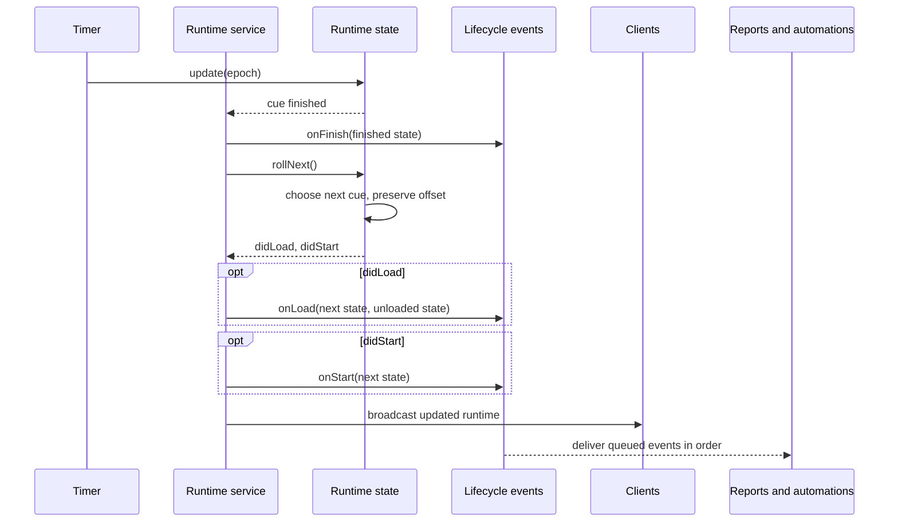

# ROLL Mode

Roll mode is intended to be fully automatic playback that takes precedence over event end actions.
It can be used on its own or after manual playback to automate sections of a rundown.

## Overview

- As long as there are non-skipped events in the rundown, we will always accept roll mode
- If there are no events in the current time frame, we load the next event and count-down to its start
- Roll will always load the first matching event in the current time, this could cause issues if there are multiple days planned or if the rundown is not in order.
- If we go from manual playback, to Roll mode, the playback should continue as is. Roll mode will automate loading the next event when the current is finished

## Implementation details

### starting to roll

> `runtimeService.roll()` calls `runtimeState.roll(rundown, metadata)`

When starting roll, the runtime state finds an event to load from the playable event order. Roll requires at least one playable event.

#### Taking over playback

If we are currently in "Play" mode and an event is playing, roll simply takes over playback. No other data changes are made

#### Starting an event

If there is nothing playing and roll finds an element that in the current time frame playing, it will start the event

#### Waiting to start

If we do not find an event that should be playing now, but find an event for the future, we load the next event, set roll mode and wait

### tick update

> `runtimeState.update(epoch)` updates the clock and timer; the runtime service handles its result

Roll shares normal timer updates and phase changes with Play mode. The runtime state also owns the transitions from a pending cue into playback and from a finished cue to the next one.

#### normal update

While a cue is running, timer phases and their integration notifications work the same way as in Play mode.

#### waiting to start

If we are currently waiting to start, we just need to update the `secondaryTimer`.
When the countdown finishes, `runtimeState.roll()` starts the cue that is already loaded.

#### an event is finished

When an event finishes, `runtimeState.rollNext()` uses `findNextRollEvent()` to skip zero-duration cues, load the next playable cue, and continue with the offset the finished event had. After the last cue it wraps to the first. If no cue has a duration, roll finds its place by the clock.
If there is a gap between the events, `secondaryTimer` counts down to the loaded cue's start.
Finish time should account for `timer.addedTime`
Finish actions are ignored in roll mode

#### time has skipped

The runtime service checks for a time skip while a cue is running and reloads roll from the clock. A jump that finishes the cue takes the finish transition first; the current clock-jump behaviour is pinned by tests.

### Playback notifications

The runtime service reports load, start, finish, phase, pause, and stop lifecycle events after changing runtime state, following the [lifecycle invariants](../../docs/agent-guides/domain-invariants.md#lifecycle-events). Reports use the state carried by each event; automations currently read the live runtime store when the event is delivered.

When a rolling cue finishes, the transition and notifications follow this sequence:

### Finding an event

> `loadRoll(rundown, metadata, timeNow)` finds the first matching cue when entering roll from the clock. `findNextRollEvent(rundown, metadata, fromId)` selects the next cue after one finishes.

As a trade-off, entering roll can load the wrong cue if the rundown is not in time order.

It is important to note that all times in the rundown are in milliseconds from midnight. In the case of multiple days being scheduled, Roll will return the first match.

### Assumptions

Both helpers use `metadata.playableEventOrder` to keep cue selection aligned with rundown indexes.

- Roll needs at least one playable event
- Playable events are assumed to be in time order

### Specification

- we should always receive an `eventNow` or `eventNext`
- if the current clock is past the last event end, we roll for the events tomorrow
- if the current clock is before the first event, we do not load next day events, even if there is a match, we always start on first day
